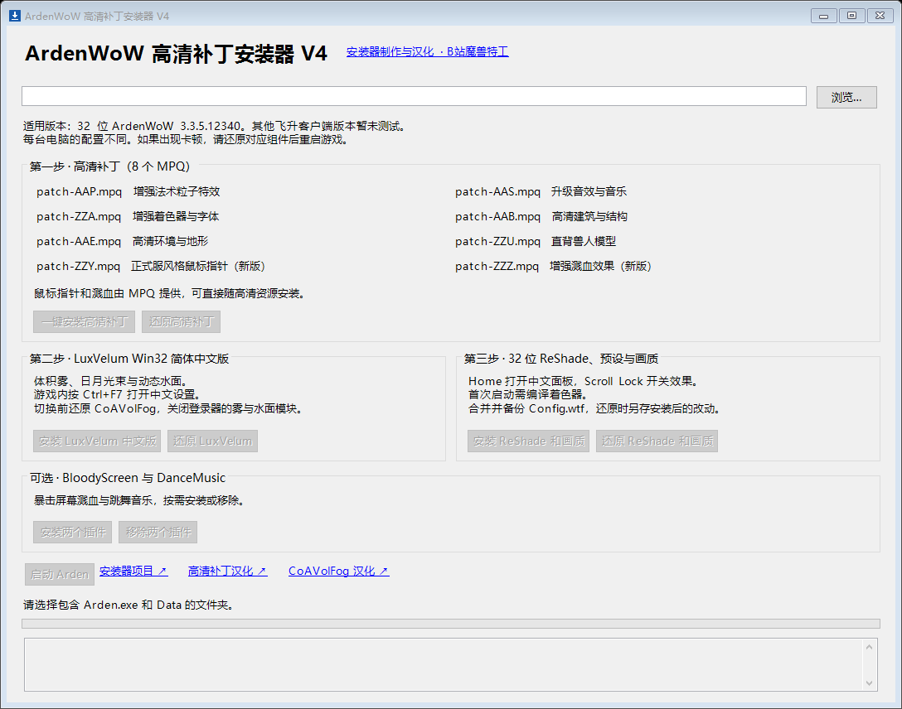

# ArdenWoW 高清补丁一键安装器 V4

面向 **32 位 ArdenWoW 3.3.5.12340** 的 Windows 安装工具。V4 支持分别安装和还原 8 个高清 MPQ、LuxVelum Win32 简体中文版、32 位 ReShade 与画质配置，以及两款可选插件。安装器制作与汉化由 [B站魔兽特工](https://space.bilibili.com/374737088) 完成。

## 下载

[百度网盘下载 ArdenWoW V4 一键安装包](https://pan.baidu.com/s/1UvSjqzH9MYLiAGns51tHlw?pwd=kf34) · 提取码 **`kf34`**

请在网盘中选择 `ArdenWoW-HD-Arden-v4.zip`，下载后完整解压。

## 使用方法

1. 退出 ArdenWoW，双击解压目录中的 `ArdenWoW 高清补丁安装器.exe`。
2. 点「浏览」，选择包含 `Arden.exe` 和 `Data` 的游戏目录。
3. 按需安装以下组件。每组都可独立安装和还原。

   | 安装选项 | 作用 |
   | --- | --- |
   | 第一步 · 高清补丁 | 加载 8 个 Arden 适用的高清 MPQ，更新场景、模型、特效、音效等资源 |
   | 第二步 · LuxVelum Win32 简体中文版 | 增强体积雾、日月光束和动态水面。游戏内按 **Ctrl+F7** 打开中文设置 |
   | 第三步 · 32 位 ReShade、预设与画质 | 安装 ReShade 6.8.0 Addon、预设和着色器，合并 `WTF/Config.wtf` 画质参数。按 **Home** 打开设置，按 **Scroll Lock** 开关效果 |
   | 可选 · BloodyScreen 和 DanceMusic | 安装或移除暴击屏幕溅血和跳舞音乐插件 |

4. 点「启动 Arden」进入游戏。首次加载 ReShade 时需要编译着色器。
5. 要撤回时，退出游戏，选中同一目录，点击对应的「还原」或「移除」按钮。

## 高清补丁

| 安装文件 | 用途 |
| --- | --- |
| `patch-AAP.mpq` | 增强法术粒子特效 |
| `patch-AAS.mpq` | 升级音效与音乐 |
| `patch-ZZA.mpq` | 增强着色器与字体 |
| `patch-AAB.mpq` | 高清建筑与结构，原包文件名为 `patch-ZZB.mpq` |
| `patch-AAE.mpq` | 高清环境与地形，原包文件名为 `patch-ZZE.mpq` |
| `patch-ZZU.mpq` | 直背兽人模型 |
| `patch-ZZY.mpq` | 新版正式服风格鼠标指针 |
| `patch-ZZZ.mpq` | 新版溅血效果 |

这 8 个文件按 Arden 兼容方案整理。指针和溅血资源随 MPQ 提供，可以直接使用。高清资源来自 [fueryin 的 CoA Ultra-HD 整合包及其兼容指南](https://github.com/fueryin/Conquest-of-Azeroth-Ultra-HD-Graphics-Modpack/blob/CoA-HD-PATCH/Compatibility%20Guide.md)，也可查看[简体中文说明](https://github.com/moshoutegong/Conquest-of-Azeroth-Ultra-HD-Graphics-Modpack-CN)。

## LuxVelum Win32 简体中文版

V4 的可选光影使用 **LuxVelum Win32 Build-1（基于 `6656eee`）**，提供体积雾、日月光束和动态水面。安装器为原版 32 位 Arden 客户端配置配套的 `version.dll` 加载器。

已经在用 [CoAVolFog 中文版](https://github.com/moshoutegong/coa-vfog-CN) 可以继续使用。若要换成 LuxVelum，请先用原安装器还原 CoAVolFog。若 Arden 登录器启用了 **Volumetric fog and water**，请先关闭该模块。两套光影择一即可。AMD 显卡可在退出游戏后将 `LuxVelum.ini` 中的 `Multisampling` 设为 `0`。

## ReShade 与画质配置

ReShade 主菜单默认使用简体中文，第三方着色器的名称和参数可能显示英文。安装器先备份完整的 `WTF/Config.wtf`，再合并选定的画质设置，保留原有的服务器、语言、分辨率、刷新率和界面缩放。若尚未生成 `Config.wtf`，请先正常启动并退出游戏一次，再安装第三步。

## 安装与还原

- 安装前检查同名文件，发现冲突时会提示。请保留 Arden 客户端自带的 `patch-ZZD.MPQ`。V2/V3 已装的同版本高清 MPQ 可沿用，并可用 V4 还原。
- 请保留游戏目录里的安装记录。还原时会核对文件，按组件提示保留或另存后来修改过的内容。
- 第三步还原时会按原字节恢复安装前的 `Config.wtf`。如果安装后改过配置，安装器会先将修改后的版本另存为 `Config.wtf.arden-v4-backup-*`。

其他客户端版本暂未测试。各台电脑的配置不同，如遇卡顿，请还原对应组件并重新启动游戏。

[查看更新记录](CHANGELOG.md) · [高清补丁中文项目](https://github.com/moshoutegong/Conquest-of-Azeroth-Ultra-HD-Graphics-Modpack-CN)
