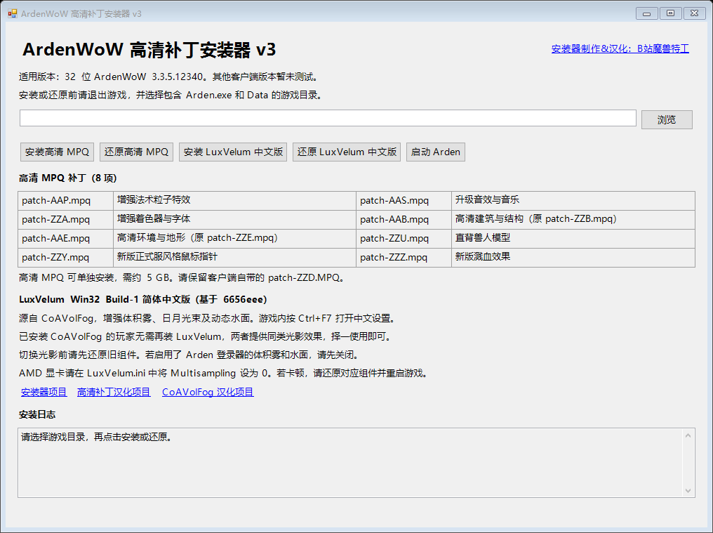

# ArdenWoW 高清补丁与 LuxVelum 中文一键安装器

面向 **32 位 ArdenWoW 3.3.5.12340** 的 Windows 安装工具。V3 支持分别安装和还原高清 MPQ 与 LuxVelum 简体中文版，也可以从窗口直接启动所选目录中的 Arden 客户端。安装器制作与汉化由 [B站魔兽特工](https://space.bilibili.com/374737088) 完成。

## 下载

**V3 的使用说明和截图已更新。** 下方是现有的 **V2 安装包**下载入口，V3 安装包的网盘地址待更新。

[百度网盘下载 V2（ArdenWoW-HD-Arden-v2.zip）](https://pan.baidu.com/s/1UvSjqzH9MYLiAGns51tHlw?pwd=kf34) · 提取码 **`kf34`** · 约 **5.01 GB**

## V3 使用方法

1. 退出 ArdenWoW，完整解压 V3 安装包。
2. 双击 `ArdenWoW 高清补丁安装器.exe`，点「浏览」选择包含 `Arden.exe` 和 `Data` 的目录。
3. 按需点击「安装高清 MPQ」或「安装 LuxVelum 中文版」。高清 MPQ 可以独立使用。
4. 点「启动 Arden」。如果安装了 LuxVelum，在游戏里按 **Ctrl+F7** 打开简体中文设置。
5. 要撤回时，退出游戏，选中同一目录，再点对应的「还原」按钮。

已经用 V2 安装高清 MPQ 的玩家可以直接沿用。V3 也能读取 V2 的高清 MPQ 还原记录。

## 高清补丁

| 安装文件 | 用途 |
| --- | --- |
| `patch-AAP.mpq` | 增强法术粒子特效 |
| `patch-AAS.mpq` | 升级音效与音乐 |
| `patch-ZZA.mpq` | 增强着色器与字体 |
| `patch-AAB.mpq` | 高清建筑与结构，原包文件名为 `patch-ZZB.mpq` |
| `patch-AAE.mpq` | 高清环境与地形，原包文件名为 `patch-ZZE.mpq` |
| `patch-ZZU.mpq` | 直背兽人模型 |
| `patch-ZZY.mpq` | 新版正式服风格鼠标指针 |
| `patch-ZZZ.mpq` | 新版溅血效果 |

这 8 个文件按 Arden 兼容方案整理。指针和溅血资源随 MPQ 提供，可以直接使用。高清资源来自 [fueryin 的 CoA Ultra-HD 整合包及其兼容指南](https://github.com/fueryin/Conquest-of-Azeroth-Ultra-HD-Graphics-Modpack/blob/CoA-HD-PATCH/Compatibility%20Guide.md)，也可查看[简体中文说明](https://github.com/moshoutegong/Conquest-of-Azeroth-Ultra-HD-Graphics-Modpack-CN)。

## LuxVelum Win32 简体中文版

V3 的可选光影使用 **LuxVelum Win32 Build-1（基于 `6656eee`）**，提供体积雾、日月光束和动态水面。安装器为原版 32 位 Arden 客户端配置配套的 `version.dll` 加载器。

已经在用 [CoAVolFog 中文版](https://github.com/moshoutegong/coa-vfog-CN) 可以继续使用。若要换成 LuxVelum，请先用原安装器还原 CoAVolFog。若 Arden 登录器启用了 **Volumetric fog and water**，请先关闭该模块。两套光影择一即可。AMD 显卡可在退出游戏后将 `LuxVelum.ini` 中的 `Multisampling` 设为 `0`。

ReShade 和 `WTF\Config.wtf` 的画质调整为手动选项。

## 安装与还原机制

- 高清安装前检查同名文件。发现冲突时停止安装并列出文件。请保留 Arden 客户端自带的 `patch-ZZD.MPQ`。
- 两组还原分别读取各自的安装记录，并用 SHA-256 核对文件。后来修改过的文件会保留并提示。
- 安装前已有的 `LuxVelum.ini` 会保留。如果改过安装器附带的配置，光影还原时会另存一份备份。

其他客户端版本暂未测试。各台电脑的配置不同，如遇卡顿，请还原对应组件并重新启动游戏。

[查看更新记录](CHANGELOG.md) · [高清补丁中文项目](https://github.com/moshoutegong/Conquest-of-Azeroth-Ultra-HD-Graphics-Modpack-CN)
