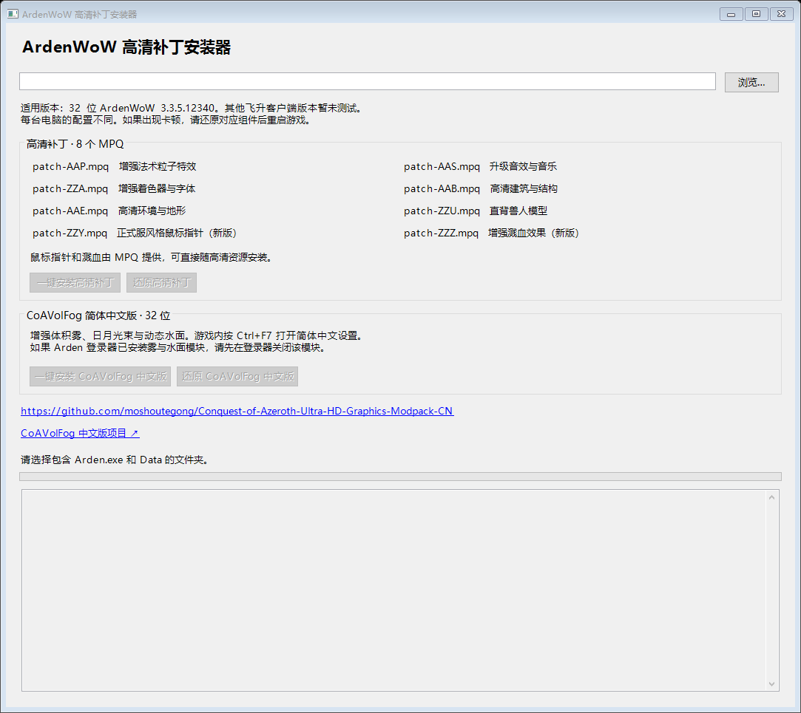

# ArdenWoW 高清补丁与 CoAVolFog 一键安装器

面向 **32 位 ArdenWoW 3.3.5.12340** 客户端的 Windows 安装工具。选好游戏目录后，可以分别安装或还原高清 MPQ 和 CoAVolFog 简体中文版。

## 下载

**[百度网盘下载 ArdenWoW-HD-Arden-v2.zip](https://pan.baidu.com/s/1UvSjqzH9MYLiAGns51tHlw?pwd=kf34)**  
提取码 **`kf34`**，压缩包约 **5.01 GB**。GitHub 仓库用于查看说明和反馈问题。

## 使用方法

1. 退出 ArdenWoW，将压缩包完整解压。
2. 双击 `ArdenWoW 高清补丁安装器.exe`，点「浏览」选择包含 `Arden.exe` 和 `Data` 的文件夹。
3. 按需点击「一键安装高清补丁」或「一键安装 CoAVolFog 中文版」。两组功能可以分别使用。
4. 启动 ArdenWoW。如果启用了 CoAVolFog，在游戏内按 **Ctrl+F7** 打开简体中文设置。
5. 要撤回时，退出游戏，打开安装器选中同一目录，点击对应的「还原」按钮。

## 高清补丁

| 安装文件 | 用途 |
| --- | --- |
| `patch-AAP.mpq` | 增强法术粒子特效 |
| `patch-AAS.mpq` | 升级音效与音乐 |
| `patch-ZZA.mpq` | 增强着色器与字体 |
| `patch-AAB.mpq` | 高清建筑与结构，原包文件名为 `patch-ZZB.mpq` |
| `patch-AAE.mpq` | 高清环境与地形，原包文件名为 `patch-ZZE.mpq` |
| `patch-ZZU.mpq` | 直背兽人模型 |
| `patch-ZZY.mpq` | 新版正式服风格鼠标指针 |
| `patch-ZZZ.mpq` | 新版溅血效果 |

这 8 个文件按 Arden 兼容方案整理。指针和溅血资源随 MPQ 提供，可以直接使用。高清资源来自 [fueryin 的 CoA Ultra-HD 整合包及其兼容指南](https://github.com/fueryin/Conquest-of-Azeroth-Ultra-HD-Graphics-Modpack/blob/CoA-HD-PATCH/Compatibility%20Guide.md)，也可查看[简体中文说明](https://github.com/moshoutegong/Conquest-of-Azeroth-Ultra-HD-Graphics-Modpack-CN)。

## CoAVolFog 简体中文版

提供体积雾、日月光束和动态水面，界面支持简体中文。本包使用 [moshoutegong 发布的 CoAVolFog Win32 中文版](https://github.com/moshoutegong/coa-vfog-CN/releases/tag/build-9-1-ea357c7)。如果 Arden 登录器已启用 **Volumetric fog and water**，请先在登录器关闭该模块。

## 安装和还原机制

- 高清安装前会检查目标目录中的同名文件，发现冲突就停止安装并列出文件。安装器新增 MPQ，游戏按补丁加载顺序读取资源。客户端自带的 `patch-ZZD.MPQ` 应保留。
- 还原按安装记录核对文件。安装包添加且内容一致的文件会移除。后来被修改过的文件会保留并提示。请保留游戏目录下的安装记录。
- CoAVolFog 会保留已有的 `CoAVolFog.ini`。若你改过本安装器添加的配置，卸载时会另存一份配置备份。

目前验证范围为 ArdenWoW 3.3.5.12340。其他客户端版本暂未测试。机器配置不同，如果出现卡顿，请还原对应组件，再重启游戏。
